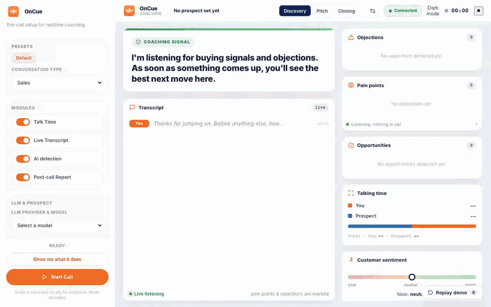
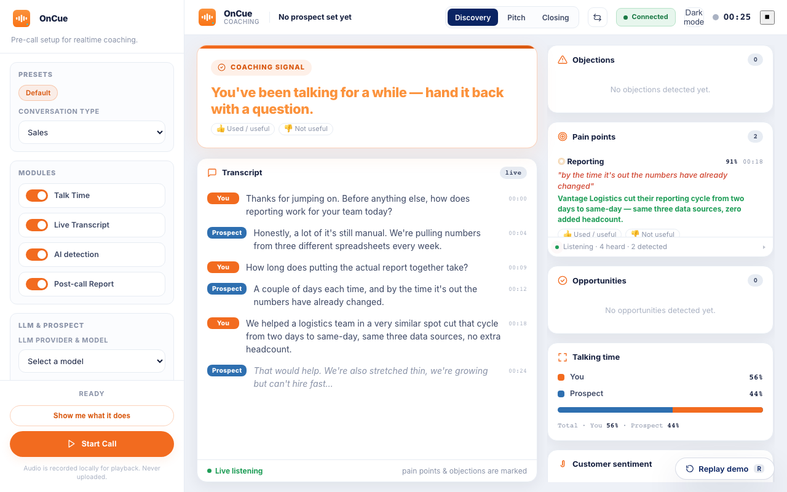
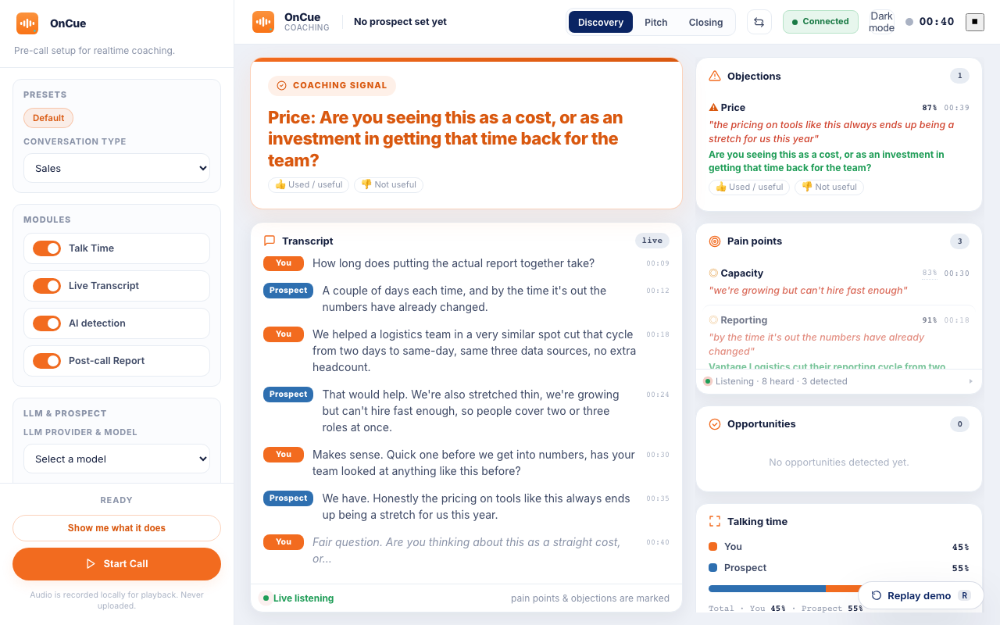

# OnCue

[](https://github.com/Vinix24/OnCue/actions)
[](LICENSE)
[](docs/BETA_TESTER_GUIDE.md)

OnCue is a local notetaker and a live copilot for conversations. It captures a call on your own computer, transcribes it there, and writes the full transcript to a file when the call ends. If you want more, it also coaches you while you talk: talk-time balance, and pain points, objections and buying signals as they come up.

Sales calls are one use, not the definition. Interviews, intake and discovery calls, coaching sessions and internal meetings run through the same pipeline. OnCue captures system audio instead of joining the call, so Teams, Zoom, Meet, Webex or a phone bridge all look the same to it, and no bot joins the meeting.

**Nederlands:** [wat OnCue is, wat er op je computer blijft en hoe je het als notulist probeert](#nederlands).

---

## Nederlands

OnCue is een notulist en een gesprekscoach die op je eigen computer draaien. Het luistert mee met een videogesprek in Teams, Zoom, Meet of een ander programma. Wat er gezegd wordt, zet het om in tekst. Na afloop staat het hele gesprek in een bestand op je computer. Coaching tijdens het gesprek is een extra mogelijkheid, die je als notulist uit laat.

**Wat op je computer blijft.** In de standaardinstelling blijven geluid en tekst op je computer. Het omzetten van spraak naar tekst gebeurt op je eigen computer. Er is geen online AI-dienst aangesloten. De tekst van het gesprek gaat nergens heen. Het geluid zelf wordt niet bewaard, tenzij je dat aanzet. Zonder licentiesleutel maakt OnCue ook geen contact met de maker.

**Wat je zelf kunt aanzetten.** Een samenvatting met actiepunten vraagt om een taalmodel. Met een taalmodel op je eigen computer blijft de tekst daar. Met de cloudomgeving van je eigen organisatie of een openbare AI-dienst gaat de tekst van het gesprek wel naar buiten. Die keuze maak je per gesprek. Twee andere instellingen halen het geluid van die lokale route af. De eerste stuurt het geluid naar de dienst Groq voor snellere transcriptie. De tweede zet de transcriptieserver open voor andere computers in je netwerk, zonder versleuteling. Beide staan standaard uit.

**Zo probeer je het als notulist.** De stappen hieronder zijn voor een Mac. Je plakt een paar regels in het programma Terminal. Voor Windows staan de stappen in [INSTALL.md](INSTALL.md#windows), in het Engels.

1. Installeer en start OnCue met de stappen onder [Install](#install).
2. Ga in je browser naar `http://localhost:8760/dashboard`. Dat adres is OnCue op je eigen computer, geen website.
3. Klik links onder **Presets** op `notetaker`.
4. Klik op **Start Call** als het gesprek begint en op **Stop & rapport** als het klaar is.
5. Het hele gesprek staat daarna als tekstbestand (JSON) in de map `data/reports` binnen de OnCue-map.

Een samenvatting erbij laten maken door een taalmodel op je eigen computer: zie [Notetaker](#notetaker). Vertel je gesprekspartners vooraf dat je het gesprek laat uitwerken. De privacy-uitleg met de AVG staat in [docs/PRIVACY.md](docs/PRIVACY.md), in het Engels.

---

## Two ways to use it

| | Notetaker | Live copilot |
|---|---|---|
| During the call | Live transcript of both sides | Live transcript, talk-time coaching and detection cards on a second screen |
| After the call | The full transcript in a file on your machine | The same file, plus detections and talk-time in the report |
| Needs an LLM | No. An LLM adds a summary and action items | No. An LLM adds summaries and live suggestions |

Both start from the same install.

## Install

macOS 13 or newer with [Homebrew](https://brew.sh). Building the local transcriber needs the Xcode command line tools and `cmake`; the installer adds Python 3.11 when it is missing. Windows: see [INSTALL.md](INSTALL.md#windows).

```bash
xcode-select --install          # skip if already installed
brew install cmake
git clone https://github.com/Vinix24/OnCue.git
cd OnCue
bash scripts/install.sh         # .venv, dependencies, whisper.cpp and its model, .env with LLM_PROVIDER=none
.venv/bin/sales-copilot start   # starts OnCue on localhost:8760 and opens the browser
```

The installer ends by suggesting an LLM API key. Neither route needs one. On first launch the browser may open a setup wizard; you can go straight to `http://localhost:8760/dashboard`. The dashboard is in Dutch by default (`LANGUAGE=nl`); set `LANGUAGE=en` in `.env` for English. Other install paths and troubleshooting: [INSTALL.md](INSTALL.md). Every setting: [docs/CONFIG.md](docs/CONFIG.md).

---

## Notetaker

1. Open `http://localhost:8760/dashboard`.
2. Under **Presets**, click `notetaker`. It turns detection, talk-time coaching and slides off, keeps the live transcript and the post-call report on, and transcribes your own microphone as well as the other side.
3. Click **Start Call** when the conversation starts and **Stop & report** (Dutch UI: *Stop & rapport*) when it ends. macOS asks once for permission to record audio. Tell the other participants that the call is transcribed ([consent](docs/PRIVACY.md#consent-for-recording)).

The transcript is then on disk, in your OnCue folder:

```
data/reports/<date>T<time>_<session-id>_report.json
```

A packaged app or a `pipx` install writes it under `~/Library/Application Support/SalesCopilot/data/reports/` instead. The `full_transcript` field lists every segment with `speaker`, `text`, `start_ms` and `end_ms`. Speakers are split by audio channel, not by person: `self` is your microphone, `prospect` is everything you hear through the computer. Per-person speaker labels are optional and local: with `DIARIZATION_ENABLED=1` the live transcriber runs pyannote and emits a separate `speaker_segments` event, but `full_transcript` and the `_transcript.md` keep the two channel names. To get a transcript with one label per person (`SPEAKER_00`, `SPEAKER_01`, ...), record the call with `RECORD_AUDIO=true` and run `scripts/post_process_call.py` on the WAV of the stream with several voices (`data/sessions/<session>/<stream>.wav`) afterwards. It writes a `<wav name>-labeled.txt` next to the WAV and does not change the report files. Setup, limits and the Hugging Face token are in [docs/DIARIZATION.md](docs/DIARIZATION.md). The audio itself is not stored unless you set `RECORD_AUDIO=true`.

Next to it sits the same transcript as a text you can read and share, with the same prefix:

```
data/reports/<date>T<time>_<session-id>_transcript.md
```

One line per segment, in time order, written as soon as the call ends. The notetaker preset names the two sides neutrally by `LANGUAGE`: `Ik` and `Gesprekspartner` in Dutch, `Me` and `Other` in English. Other presets use their own speaker names, for example `verkoper` and `prospect`. The **Download Report (Markdown)** button in the report view ends with the same transcript, with the same names. The file follows `REPORT_REDACT_PII`: with it on, the PII redaction of the JSON applies to the `.md` as well.

What else the JSON file holds depends on the LLM setting:

- **No LLM (`LLM_PROVIDER=none`, the default):** the transcript, the call's start and end time, its duration and the talk-time split. The summary fields (`short_summary`, `overview`, `keywords`, `action_items`) stay empty. No transcript text is sent anywhere.
- **A local model**, for example Ollama on this machine: add `REPORT_LLM_PROVIDER=ollama` and `REPORT_LLM_MODEL=<a model you pulled>` to `.env`. After the call the whole transcript goes to that model, and the same file gets a short summary, an overview, keywords and action items. The text stays on the machine.
- **Your own cloud tenant** (`azure` or `vertex` as `REPORT_LLM_PROVIDER`, with its model and credentials): the same fields, and the transcript stays inside a cloud boundary your organization already governs.

Use the `REPORT_LLM_*` keys rather than `LLM_PROVIDER` for this. The dashboard sends its own model choice with every call, and when its picker is left on *Select a model*, that empty choice overrides `LLM_PROVIDER` for the call.

The dashboard shows the report after the call. Its JSON and Markdown download buttons export that report view, not the transcript; the transcript is only in the file above. By default it stays there until you delete it.

---

## Live copilot

The coaching route: a live transcript, talk-time coaching on your second screen, and pain points, objections and buying signals as they come up. Detection runs through `semantic-router`, an embedding classifier that stays local, so it works without an LLM.

1. Open `http://localhost:8760/dashboard`.
2. Under **Modules**, check that **Talk Time**, **Live Transcript** and **AI detection** (Dutch UI: *AI detectie*) are on. The `discovery`, `coaching_only` and `notetaker` presets leave detection off on purpose.
3. Click **Start Call**.

With an LLM provider set, OnCue also uses it for window classification, a rolling summary, live suggestions and the post-call report. Choosing one: [INSTALL.md](INSTALL.md#choosing-an-llm-provider). Detection profiles for other conversation types: [docs/PRESETS.md](docs/PRESETS.md).

### Demo



A scripted discovery call playing through the coaching dashboard: live transcript, pain points firing, a monologue coaching alert with the talk-time split, a price objection with its counter-response suggestion, and a buying signal.

| Talk-time coaching | Objection detected |
|---|---|
|  |  |

---

## Privacy

Privacy is the default, not an option you opt into. Audio capture, transcription, and pain-point detection run on your machine by default. No LLM is configured by default. Transcript text only leaves the machine if you explicitly configure an LLM destination, and that choice is made per conversation, not locked in at install time.

| Where LLM text goes | What it means | When to use it |
|---|---|---|
| **No LLM (default)** | `LLM_PROVIDER=none`. The live cues (embedding-based detection and talk-time coaching) run fully local. No transcript text is sent anywhere. | Default. Sensitive or regulated calls. |
| **Local LLM of your choice** | For example `LLM_PROVIDER=ollama` with a model you run yourself. The text stays on the machine. | Calls where you want LLM-backed features without any outbound text. |
| **Own cloud tenant** | Your own Azure OpenAI subscription or Vertex AI project. The text stays inside a cloud boundary your organization already governs. | Regulated B2B where a new processor is a procurement blocker. |
| **Public provider with your own key** | A public API (OpenAI, OpenRouter, Groq, Gemini). | Internal meetings, sales training, or any call where the sensitivity allows it. |

**Text.** With an LLM configured, what is sent depends on the task: a sliding window of prospect speech for detection, a rolling summary input (every 60 seconds, up to 40 lines with speaker labels), live suggestions with your uploaded context documents, and the whole transcript for the post-call report. All of it passes one PII seam first. That redaction is pattern based (no name recognition beyond a fixed list of Dutch first names), so it is a safety net and not a guarantee. The first three tasks run inside detection, which the notetaker preset switches off. A notetaker call therefore sends text only in the post-call report step: the whole transcript, after the call.

**Audio.** By default audio never touches a network call. One opt-in route sends audio off the machine: `WHISPER_BACKEND=groq` uploads every audio chunk to Groq. Binding the whisper.cpp server to a non-loopback `WHISPER_CPP_SERVER_HOST` is not local either: it opens an unencrypted listener on your network. Neither is on by default, no PII filter runs on audio, and a client's privacy ceiling refuses both.

**No calls to the maker.** Without a license key, the open source version makes no call to the maker: no license check, no central audit, and the measurement signals are off.

No LLM key or model ships with OnCue. Per task, the limits of the redaction, AVG/GDPR and the AI Act: [docs/PRIVACY.md](docs/PRIVACY.md). The invariants CI checks on every PR: [docs/ARCHITECTURE_BOUNDARIES.md](docs/ARCHITECTURE_BOUNDARIES.md).

---

## How it works

```
Audio (mic + system) ─┬─▶ Transcription (whisper.cpp, local) ─┬─▶ Live transcript in the dashboard
                      │                                        ├─▶ Post-call report file
                      │                                        └─▶ Detection (semantic-router) ─▶ Coaching dashboard
                      └─▶ VAD (talk-time) ──────────────────────────────────────────────────────▶ Coaching dashboard
```

The notetaker uses transcription, the live transcript and the report file. The live copilot adds detection and talk-time. All components talk over WebSocket on `localhost:8760`, and every module runs and tests on its own. Full breakdown: [docs/ARCHITECTURE.md](docs/ARCHITECTURE.md).

## Platform support

**macOS** is the primary platform. AudioTee's whole-system audio tap is the default capture path, with no virtual audio device needed. **Windows** works through WASAPI loopback: anything playing through the system is captured, so calls in Teams, Zoom and Meet behave the same as on macOS. Setup and current limits: [INSTALL.md](INSTALL.md#windows) and [KNOWN_ISSUES.md](KNOWN_ISSUES.md).

## Documentation

| Document | Covers |
|---|---|
| [INSTALL.md](INSTALL.md) | Install paths, LLM providers, Windows, troubleshooting |
| [docs/PRIVACY.md](docs/PRIVACY.md) | What leaves the machine per task, PII redaction, AVG/GDPR and the AI Act |
| [docs/ARCHITECTURE.md](docs/ARCHITECTURE.md) | Full architecture: data plane, BYO-tenant boundary, component diagram |
| [docs/ARCHITECTURE_BOUNDARIES.md](docs/ARCHITECTURE_BOUNDARIES.md) | The invariants CI enforces (local-first, provider-agnostic, localhost-only, ...) |
| [docs/CONFIG.md](docs/CONFIG.md) | Full `.env` configuration reference |
| [docs/PRESETS.md](docs/PRESETS.md) | Module presets and detection profiles per conversation type |
| [docs/USE_CASES.md](docs/USE_CASES.md) | Conversation types and their legal context |
| [docs/FEATURES.md](docs/FEATURES.md) | Free vs. Pro feature matrix |
| [docs/BENCHMARKS.md](docs/BENCHMARKS.md) | Local latency per pipeline stage, measured on real hardware |
| [docs/FAQ.md](docs/FAQ.md) | Common setup and usage questions |
| [docs/TROUBLESHOOTING.md](docs/TROUBLESHOOTING.md) | Diagnosing setup problems |
| [docs/INDEX.md](docs/INDEX.md) | Full documentation index |

## Testing

```bash
source .venv/bin/activate
python -m pytest tests/
```

CI runs the full suite on every PR (see the badge at the top of this file).

---

## License

The core is licensed under **AGPL-3.0** ([LICENSE](LICENSE)): anyone who distributes a modified version or runs it as a network service must publish their modifications under the same license. A [commercial license](LICENSE-COMMERCIAL.md) is available for organizations that cannot operate under AGPL terms. Pro and Enterprise features are proprietary extensions distributed separately under that commercial license; the free, self-hosted core in this repo is complete and fully functional on its own. Third-party attribution: [THIRD_PARTY_LICENSES.md](THIRD_PARTY_LICENSES.md).

## Contributing

Pull requests are welcome. Read [CONTRIBUTING.md](CONTRIBUTING.md) first. Contributors agree to [CLA.md](CLA.md); community conduct is governed by [CODE_OF_CONDUCT.md](CODE_OF_CONDUCT.md). For security disclosures, follow [SECURITY.md](SECURITY.md) instead of opening a public issue.

## Links

- Website: [oncueassistant.com](https://oncueassistant.com)
- Issues: [GitHub Issues](https://github.com/Vinix24/OnCue/issues)
- Contact: info@vincentvandeth.nl
